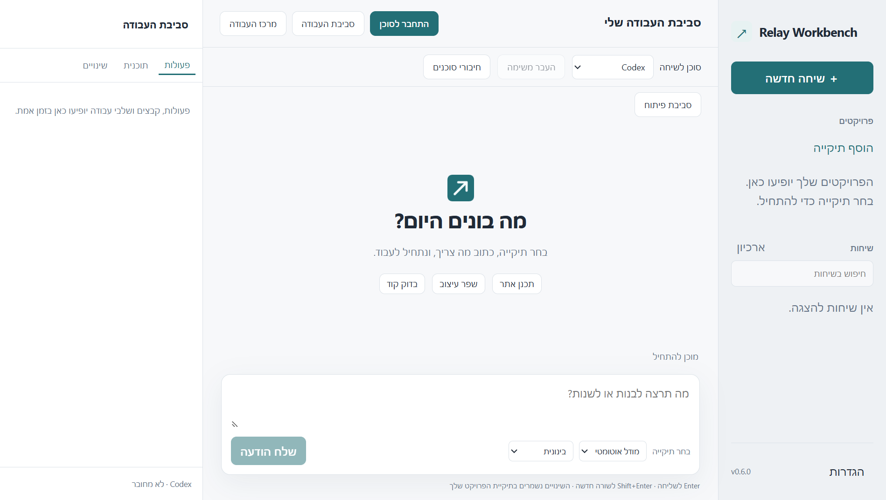

# Relay Workbench

An independent Windows desktop workbench for coding agents, with a Hebrew RTL interface.
Choose an agent per conversation, review changes and hand work to another agent.

**0.6.0 developer preview · complete maintained application source · MIT**

All application UI assets are generated from src/. No legacy React bundle, embedded font,
original application executable or proprietary provider runtime is included in the source export.
This is not an official product of OpenAI, Anthropic, Google or GitHub.



## Download

[Windows x64 installer](https://github.com/huxhkuh/relay-workbench/releases/download/v0.6.0/Relay-Workbench-Setup-0.6.0-x64.exe) ·
[Portable ZIP](https://github.com/huxhkuh/relay-workbench/releases/download/v0.6.0/Relay-Workbench-0.6.0-x64.zip) ·
[Product website](https://huxhkuh.github.io/relay-workbench/) ·
[SHA-256 checksums](https://github.com/huxhkuh/relay-workbench/releases/download/v0.6.0/SHA256SUMS.txt)

Windows 10/11 x64. This developer preview is unsigned and uses a Hebrew interface.
Provider tools, accounts and the optional Claude SDK are installed separately.
The installer supports per-user installation and keeps the existing conversation profile.

## What it does

- Codex, Claude, Antigravity, OpenCode, Cline, Copilot, Gemini and custom local ACP adapters.
- Streaming Markdown chat, account/model settings, paged history and reviewed handoff drafts.
- Explicit tool/permission approvals, questions, typed MCP forms and active-request URL flows.
- CodeMirror editor, conflict protection, file context, search, command output and Git tools.
- Isolated background worktrees, project instructions/skills/MCP, recovery and diagnostics.
- Light/dark themes, keyboard shortcuts and an interface rebuilt from editable source.

Provider capabilities and account entitlement vary. The app does not provide subscriptions or free model usage.
See [capabilities](CAPABILITIES.md), [feature parity](FEATURE-PARITY.md) and [validation](VALIDATION.md).

## Develop (Windows)

Prerequisites: Node.js 26, npm and Git. Install the official agent CLI you want separately.

```powershell
npm ci
npm run build
npm test
npm start
```

Electron downloads its pinned official runtime on first use. On a network using a trusted local CA,
use Node's system CA support for that process (NODE_USE_SYSTEM_CA=1); do not disable TLS verification.
Choose an external Codex executable in Settings if it is not discovered on PATH.

Claude integration additionally needs an explicit, separate SDK installation:

```powershell
npm run setup:claude
```

That installer uses a separate pinned lockfile and installs to LocalAppData/RelayWorkbench/claude-sdk.
The SDK remains subject to Anthropic terms and is not bundled or relicensed under this project's MIT license.
The official Claude CLI and an entitled account are still required.

## Build and verify

```powershell
npm run check:build
npm run package:win
npm run test:e2e
npm run installer:win
npm run export:source
```

The Windows package uses official Electron from the npm dependency, not any previous app installation.
Agent CLIs and the optional Claude SDK are not distributed with it. Existing Boau Code profiles and
internal identifiers are retained for compatibility. Native smoke tests use disposable profiles and
provider doubles; they do not make paid inference calls. Do not run package mutation tests concurrently.
The source export excludes generated outputs, installs, histories and credentials; it does not publish.

## Project information

[Hebrew guide](README.he.md) · [Contributing](CONTRIBUTING.md) · [Security](SECURITY.md) ·
[Privacy](PRIVACY.md) · [Licenses and provenance](SOURCE-PROVENANCE.md) · [Release checklist](PUBLIC-RELEASE.md)

Project code uses the [MIT license](LICENSE). Dependencies retain their own terms.
ACP catalog metadata includes its Apache-2.0 license. Build output includes dependency notices;
Electron packages retain Electron/Chromium notices. The original assets have been removed rather
than presented as new MIT source. This preview is unsigned and has no automatic update service.

## Installer and website source

electron-builder.config.cjs and tools/build-installer.cjs create the branded NSIS EXE and portable ZIP
under release/publish. Code signing is explicitly disabled for this preview; no certificate is bundled.
A compatibility minimatch override fixes a builder dependency advisory and has been checked through
actual Windows packaging. The source application still uses the separate default lockfile.

The public Hebrew/English download site is buildless source in website/public/.
Run npm run website:serve, then npm run website:check in another terminal for isolated Edge QA.
After building both release artifacts, npm run release:metadata writes their real sizes, links and SHA-256
values to the website and release checksum file. Publish the website through the manual Pages workflow.
